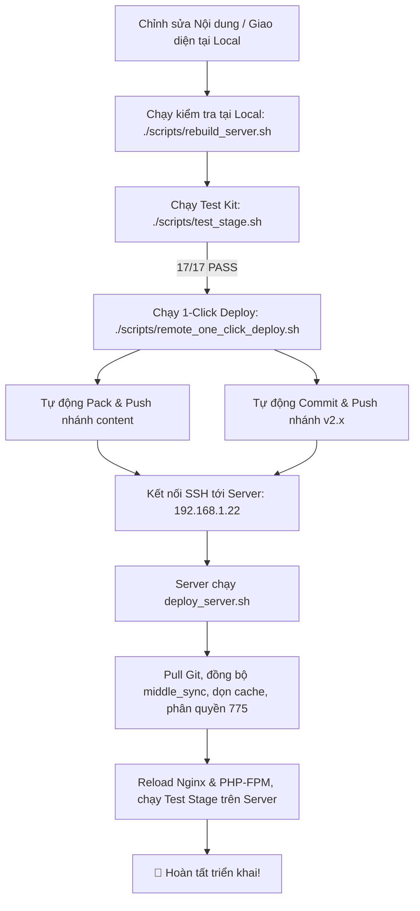

# SỔ TAY HƯỚNG DẪN QUẢN TRỊ & VẬN HÀNH HỆ THỐNG SCRIPTS
> **Dự án Thư Viện Phật Pháp & Tịnh Độ (Typemill CMS)**  
> *Phiên bản tài liệu: 2.2 — Cập nhật lần cuối: 2026-11-06*

---

> [!IMPORTANT]
> **QUY TẮC BẮT BUỘC ĐỐI VỚI LẬP TRÌNH VIÊN & AGENT AI:**  
> 1. Toàn bộ các script `.sh` trong thư mục `scripts/` **tuyệt đối không được hardcode đường dẫn thư mục hay thông tin server**.  
> 2. **Kiến trúc 2 Repository Độc Lập:** Web root (`v2.x`) và Content (`content`) là hai Git repository hoàn toàn độc lập, **không sử dụng Git submodule**. Thư mục `content/` được `.gitignore` ở Web root để hai nhánh commit/push tự do mà không bao giờ báo conflict hay sai lệch hash con trỏ.
> 3. **Mỗi khi có thêm bớt script, đổi tên file hoặc thay đổi logic triển khai, BẮT BUỘC PHẢI CẬP NHẬT ĐỒNG BỘ VÀO BẢN HƯỚNG DẪN NÀY (`scripts/README.md`)**.

---

## 1. Cấu Trúc Biến Cấu Hình & File Setting Tập Trung

Tất cả các script trong hệ thống đều tự động nạp cấu hình thông qua [`scripts/config.sh`](file:///var/www/html/phatphap/scripts/config.sh). File này sẽ đọc cấu hình từ [`scripts/deploy.env`](file:///var/www/html/phatphap/scripts/deploy.env).

### 1.1. Các biến cấu hình trong `scripts/deploy.env`

| Biến | Ý nghĩa | Giá trị mặc định |
| :--- | :--- | :--- |
| `SSH_HOST` | Địa chỉ IP hoặc domain của Production Server | `192.168.1.22` |
| `SSH_PORT` | Cổng SSH của server | `22` |
| `SSH_USER` | Tên tài khoản SSH | `quannd` |
| `SSH_KEY` | Đường dẫn tới SSH Private Key | `~/.ssh/ssh_key/quannd_id_rsa` |
| `REMOTE_WEB_ROOT` | Đường dẫn thư mục web trên Remote Server | `/var/www/html/phatphap` |
| `WEB_ROOT` | Đường dẫn thư mục web cục bộ (Local) | *Tự động nhận diện theo thư mục script* |
| `WEB_URL` | URL website dùng cho warmup cache & bộ test kit | *Tự đọc từ `settings.yaml` hoặc `http://localhost/phatphap`* |

### 1.2. Ba cách tùy biến linh hoạt khi thực thi

1. **Cách 1 (Khuyến nghị): Chỉnh sửa file `scripts/deploy.env`**  
   File này nằm cục bộ, cho phép bạn thiết lập IP, đường dẫn máy chủ, khóa SSH một lần và dùng cho mọi script.
2. **Cách 2: Truyền biến môi trường trực tiếp trên dòng lệnh (Inline override)**  
   ```bash
   SSH_HOST="10.0.0.50" SSH_PORT="2222" ./scripts/remote_one_click_deploy.sh
   WEB_URL="http://192.168.1.22/phatphap" ./scripts/test_stage.sh
   ```
3. **Cách 3: Truyền tham số cờ lệnh (CLI flags)**  
   ```bash
   ./scripts/remote_one_click_deploy.sh --host=192.168.1.22 --user=quannd --port=22 --path=/var/www/html/phatphap
   ```

---

## 2. Danh Mục Các Script & Hướng Dẫn Sử Dụng

### 2.1. `remote_one_click_deploy.sh` — Triển khai 1-Click từ Local lên Server
* **Vị trí:** [`scripts/remote_one_click_deploy.sh`](file:///var/www/html/phatphap/scripts/remote_one_click_deploy.sh)
* **Mục đích:** Tự động hóa toàn bộ quy trình đẩy code từ máy phát triển (Local/WSL) lên Production Server qua SSH.
* **Quy trình thực hiện:**
  1. *Local:* Đóng gói cấu hình chung `settings.yaml`, media, plugins vào `content/middle_sync/`.
  2. *Local:* Kiểm tra, commit và push nhánh `content` lên GitHub.
  3. *Local:* Kiểm tra, commit và push nhánh Web root (`v2.x`) lên GitHub độc lập.
  4. *SSH:* Kết nối tới Server theo cấu hình, gọi script triển khai trên server (`--server`).
* **Lệnh chạy:**
  ```bash
  # Chạy quy trình 1-click tiêu chuẩn:
  ./scripts/remote_one_click_deploy.sh

  # Bật chế độ Force Pull (tự động reset hard khi git remote có forced push hoặc phân kỳ):
  ./scripts/remote_one_click_deploy.sh --force

  # Bỏ qua git push tại local (khi đã push trước đó):
  ./scripts/remote_one_click_deploy.sh --skip-push

  # Chỉ định nhanh host khác:
  ./scripts/remote_one_click_deploy.sh --host=192.168.1.50
  ```

---

### 2.2. `deploy_server.sh` — Triển khai trực tiếp trên Remote Server
* **Vị trí:** [`scripts/deploy_server.sh`](file:///var/www/html/phatphap/scripts/deploy_server.sh)
* **Mục đích:** Chạy trực tiếp trên Production Server để cập nhật dữ liệu và áp dụng vào Web Server.
* **Quy trình thực hiện:**
  1. Kéo dữ liệu mới nhất từ nhánh `content` trên GitHub (`git pull --ff-only origin content`, hỗ trợ tự động fallback sang `git reset --hard origin/content` khi có forced push).
  2. Đồng bộ `settings/settings.yaml`, plugins và media tùy biến từ `content/middle_sync/` vào thư mục hệ thống (bảo vệ tuyệt đối secrets và user logins).
  3. Xóa sạch cache navigation (`data/navigation/`) và Twig template cache (`cache/`).
  4. Phân quyền ghi chuẩn `775` cho `www-data` trên các thư mục dữ liệu (`cache`, `content`, `data`, `media`, `settings`).
  5. Kiểm tra cú pháp Nginx (`nginx -t`) và reload an toàn `php8.4-fpm` cùng `nginx`.
  6. Tự động tái tạo Search Index toàn trang (`build_search_index.php`).
  7. Kích hoạt bộ kiểm thử tự động `test_stage.sh`.
* **Lệnh chạy:**
  ```bash
  # Chạy bằng user SSH deploy thông thường (không cần sudo):
  ./scripts/deploy_server.sh

  # Chạy cưỡng bức cập nhật commit mới nhất (Force Pull):
  ./scripts/deploy_server.sh --force
  ```

---

### 2.3. `rebuild_server.sh` — Tái tạo nhanh Cache & Search Index tại chỗ
* **Vị trí:** [`scripts/rebuild_server.sh`](file:///var/www/html/phatphap/scripts/rebuild_server.sh)
* **Mục đích:** Sử dụng khi bạn vừa chỉnh sửa file markdown, cấu hình hoặc code tại chỗ mà không cần git pull/deploy đầy đủ.
* **Quy trình thực hiện:**
  - Đồng bộ `middle_sync/` (nếu có).
  - Dọn sạch cache navigation và Twig cache.
  - Tái tạo Search Index toàn trang (`build_search_index.php`).
  - Thiết lập quyền 775 cho `www-data`.
  - Reload PHP-FPM và Nginx.
  - Tự động gửi request warm-up để Typemill tái sinh navigation ngay lập tức.
* **Lệnh chạy:**
  ```bash
  ./scripts/rebuild_server.sh
  ./scripts/rebuild_server.sh --pull   # Kèm theo git pull nếu muốn
  ```

---

### 2.4. `test_stage.sh` — Bộ Test Kit kiểm tra toàn diện 17 tiêu chí
* **Vị trí:** [`scripts/test_stage.sh`](file:///var/www/html/phatphap/scripts/test_stage.sh)
* **Mục đích:** Kiểm tra tự động tính sẵn sàng của website sau khi deploy hoặc rebuild.
* **Các hạng mục kiểm thử:**
  1. *HTTP Status Codes*: Kiểm tra mã 200 OK của `/`, `/phat-giao`, `/nhan-qua`, `/giao-duc`, `/thong-bao`, `/tm/login`.
  2. *Link & URL Integrity*: Quét mã nguồn HTML đảm bảo không còn link rác (`wsl_localhost`, dev IP) và menu dùng đúng Relative URL.
  3. *Bảo mật Nginx*: Kiểm tra chặn mã 404/403 đối với các thư mục nhạy cảm (`settings/settings.yaml`, `data/navigation/`, `content/index.yaml`, `cache/`).
  4. *Quyền thư mục hệ thống*: Đảm bảo các thư mục `cache/`, `content/`, `data/`, `media/`, `settings/` tồn tại và có quyền ghi.
* **Lệnh chạy:**
  ```bash
  ./scripts/test_stage.sh
  ./scripts/test_stage.sh http://localhost/phatphap
  ./scripts/test_stage.sh https://qts-home.duckdns.org/phatphap
  ```

---

### 2.5. `pack_middle_sync.sh` & `sync_to_middle.sh` — Đóng gói tài nguyên dùng chung
* **Vị trí:** [`scripts/pack_middle_sync.sh`](file:///var/www/html/phatphap/scripts/pack_middle_sync.sh), [`scripts/sync_to_middle.sh`](file:///var/www/html/phatphap/scripts/sync_to_middle.sh)
* **Mục đích:** Do hệ thống tách riêng Git Web root (`v2.x`) và Git Content (`content`), các tài nguyên như file âm thanh, ảnh (`media/`), plugin đặc thù (`plugins/mediaplayer/`) và cấu hình giao diện chung (`settings/settings.yaml`) được đóng gói vào thư mục trung gian `content/middle_sync/` để đồng bộ theo nhánh `content`.
* **Lưu ý an toàn:** Script tự động loại trừ các file nhạy cảm (`settings/secrets.yaml`, `settings/users/`, khóa bảo mật) để không bao giờ lộ mật khẩu hay secret key lên Git.
* **Lệnh chạy:**
  ```bash
  ./scripts/pack_middle_sync.sh
  ./scripts/sync_to_middle.sh -m "Cập nhật media, plugins và settings"
  ```

---

### 2.6. `build_search_index.php` — Tạo chỉ mục tìm kiếm Client-Side
* **Vị trí:** [`scripts/build_search_index.php`](file:///var/www/html/phatphap/scripts/build_search_index.php)
* **Mục đích:** Quét toàn bộ cây thư mục `content/`, trích xuất tiêu đề, mô tả và nội dung bài viết để tạo file JSON siêu nhẹ [`themes/tinhdo/js/search-index.json`](file:///var/www/html/phatphap/themes/tinhdo/js/search-index.json).
* **Lệnh chạy:**
  ```bash
  php scripts/build_search_index.php
  ```

---

### 2.7. `rebuild_buhd_summaries.py` & `rebuild_karma_books.py` — Tiện ích xử lý dữ liệu
* **`rebuild_buhd_summaries.py`**: Tự động đọc nội dung 7 tập Báo Ứng Hiện Đời trong `12-doc-sach/`, sinh tóm tắt chuẩn xác bản chất nhân quả và cập nhật vào các file YAML `01-bao-ung-hien-doi-tuyen-tap.yaml` đến `08-bao-ung-hien-doi-tap-7.yaml`.
* **`rebuild_karma_books.py`**: Chuẩn hóa văn bản, ghép nối các chữ rơi đầu dòng (drop-caps), chuyển đổi số chú thích inline thành số mũ unicode (`¹`, `²`) và đưa phần giải nghĩa xuống chân bài viết.
* **Lệnh chạy:**
  ```bash
  python3 scripts/rebuild_buhd_summaries.py
  python3 scripts/rebuild_karma_books.py
  ```

---

### 2.8. `pull_tp_update.sh` — Cập nhật Core Typemill Upstream
* **Vị trí:** [`scripts/pull_tp_update.sh`](file:///var/www/html/phatphap/scripts/pull_tp_update.sh)
* **Mục đích:** Kéo bản cập nhật mã nguồn Typemill mới nhất từ remote `tp` (`https://github.com/typemill/typemill.git`) đồng thời **bảo vệ tuyệt đối thư mục `content` độc lập** không bị ảnh hưởng hay conflict với mã nguồn Typemill mặc định.
* **Lệnh chạy:**
  ```bash
  ./scripts/pull_tp_update.sh           # Lấy bản mới nhất nhánh tp/v2.x
  ./scripts/pull_tp_update.sh 2.8.1     # Lấy theo tag phiên bản
  ```

---

## 3. Quy Trình Vận Hành Thường Dùng (Workflows)



---

## 4. Xử Lý Các Sự Cố Phổ Biến (Troubleshooting)

1. **Lỗi `cannot execute: required file not found`**  
   - *Nguyên nhân:* Do file script bị lưu dưới định dạng Windows CRLF (`\r\n`), hệ điều hành Linux tìm trình thông dịch `/bin/bash\r` không tồn tại.  
   - *Xử lý:* Hệ thống đã có `.gitattributes` để tự động chuẩn hóa LF. Nếu gặp lại, chạy:
     ```bash
     sed -i 's/\r$//' scripts/*.sh
     ```

2. **Lỗi `Permission denied` hoặc `insufficient permission for adding an object to repository`**  
   - *Nguyên nhân:* Một số file do user khác hoặc root tạo ra trong `.git`.  
   - *Xử lý:* Trên server, các thư mục đã được cấu hình group `www-data` và user `quannd` có quyền `775`. Chạy lệnh phân quyền nếu cần:
     ```bash
     sudo chown -R quannd:www-data /var/www/html/phatphap
     sudo chmod -R 775 /var/www/html/phatphap/content /var/www/html/phatphap/cache /var/www/html/phatphap/data
     ```

3. **Lỗi `Unable to create ... index.lock: File exists`**  
   - *Nguyên nhân:* Quá trình git trước đó bị gián đoạn để lại file khóa rác.  
   - *Xử lý:* Script `remote_one_click_deploy.sh` đã tích hợp tự động dọn dẹp `.git/index.lock`. Bạn cũng có thể xóa thủ công:
     ```bash
     rm -f .git/index.lock content/.git/index.lock
     ```

4. **Lỗi `fatal: Not possible to fast-forward, aborting` (Diverging branches)**  
   - *Nguyên nhân:* Khi remote repository bị forced push hoặc commit trên server bị phân kỳ so với GitHub remote branch.  
   - *Xử lý:*
     - Chạy deploy với cờ `--force` để tự động reset hard về commit mới nhất trên GitHub:
       ```bash
       ./scripts/remote_one_click_deploy.sh --force
       ```
     - Hệ thống hiện tại đã tích hợp cơ chế tự động fallback: nếu lệnh `pull --ff-only` gặp lỗi phân kỳ, script sẽ tự động chuyển sang `git reset --hard origin/<branch>` để quy trình triển khai không bao giờ bị dừng lại.
